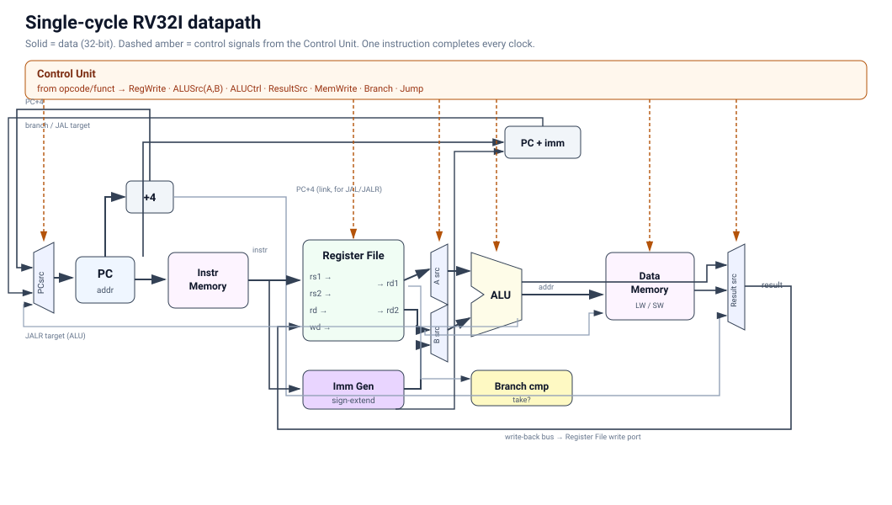

# CPU notes

The CPU executes one instruction per clock cycle. Instruction fetch, decoding,
register reads, the ALU, and memory reads are combinational. The PC, register
writes, and data memory writes update on the rising clock edge.

## Main pieces

`riscv_cpu.v` connects the control unit, datapath, and memories. `control.v`
decodes the opcode, and `alu_decoder.v` selects the ALU operation from the
instruction fields. `defines.vh` holds the shared encodings.

The register file has 32 registers with two read ports and one write port.
Reads of x0 return zero and writes to it are ignored. The immediate generator
handles I, S, B, U, and J formats. Signed comparisons and arithmetic right
shifts use signed operands explicitly.

The next PC is normally PC + 4. Taken branches and `jal` use PC + immediate;
`jalr` uses rs1 + immediate with bit 0 cleared. Jump instructions write PC + 4
to the destination register.

Both memories default to 1024 32-bit words. Addresses are byte addresses, so
memory indexing uses bits 31:2. Only aligned word accesses are supported;
there is no misalignment trap or memory protection. The testbench loads
instructions into `dut.u_imem.mem` using `$readmemh`.

## Simulation

`make test` runs the PC, ALU, register file, immediate generator, and branch
unit tests, followed by three CPU tests:

- `test_arith`: integer arithmetic, logic, shifts, and comparisons
- `test_loop`: sum 1 through 10 (55), then store and load the result
- `test_jumps`: calls and returns, `lui`, and `auipc`

Assembly sources and generated hex files live in `testbench/programs/`.
Programs finish with a branch to themselves. The testbenches run for a fixed
number of cycles and check registers or memory afterward.

For another program, assemble its `.s` file with `make asm SRC=path/to/file.s`,
then add a testbench that loads the resulting `.hex` and checks its results.
Add the testbench to the Makefile to run it with the others.

For waveforms, add `$dumpfile("wave.vcd");` and `$dumpvars(0, tb_cpu_loop);`
to the testbench's initial block, rerun it, and open `wave.vcd` in GTKWave.
Use the matching testbench name when tracing a different test.

## Limitations and possible additions

This is a small simulation project. Byte and half-word loads/stores and more
instruction tests would be useful next additions. Pipelining and FPGA support
would need further work on timing, hazards, and memory interfaces.

The single-cycle organization follows the design described in Harris and
Harris, *Digital Design and Computer Architecture: RISC-V Edition*.
